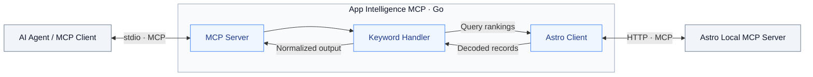

# App Intelligence MCP

A Go MCP server that brings mobile app intelligence to AI agents, starting with App Store Optimization (ASO) data from Astro.

> **Early development:** Live Astro integration is working. Mixpanel and combined analytics are planned. Tool contracts may change; the project is not yet production-ready.

## Current capabilities

- MCP server built with the official Go SDK, exposing a local stdio interface
- Astro integration through its local Streamable HTTP MCP server
- Keyword rankings filtered by keyword, store, and platform
- Structured output distinguishing ranked, missing, and outside-chart values
- Provider update timestamps preserved in results
- Historical comparison in the standalone probe program
- Unit tests, offline MCP integration tests, and an opt-in live Astro test

## Requirements

- Go: developed with Go 1.26.3; see `go.mod` for the declared version
- For live use: Astro running on the same machine with its MCP server enabled
- An Astro version exposing `get_keyword_performance`

The current application connects to `http://127.0.0.1:8089/mcp` during startup. If the connection fails, the application exits. Normal tests use a fake provider and require neither Astro nor a Claude subscription.

## Getting started

From the repository directory:

```sh
go mod download
go test ./...
go build -o app-intelligence-mcp .
```

Enable Astro's MCP server in its settings before launching the application.

The binary is intended to be launched by an MCP client using stdio. Running it directly waits for MCP messages; it does not open an HTTP endpoint or an interactive prompt. Protocol messages use stdout; logs use stderr.

External client configuration and subprocess-based stdio invocation have not yet been verified. Live verification so far uses an in-memory MCP client connected to our server, which calls Astro over HTTP.

## Tool: `get_keyword_rankings`

Queries Astro's `get_keyword_performance` tool and returns normalized records.

### Input

```json
{
	"keyword": "dibujo digital",
	"store": "es",
	"platform": "iphone"
}
```

| Field      | Meaning                                                                |
| ---------- | ---------------------------------------------------------------------- |
| `keyword`  | Search text; Astro uses case-insensitive partial matching              |
| `store`    | App Store country code, such as `es` or `us`                           |
| `platform` | Astro platform: `iphone`, `ipad`, `mac`, `appletv`, or `realityDevice` |

All three fields are part of the current input contract. The handler rejects empty or whitespace-only keywords. Additional store and platform validation is planned.

### Structured output

Illustrative response; values depend on the user's tracked data:

```json
{
	"rankings": [
		{
			"app": "Example App",
			"keyword": "dibujo digital",
			"store": "es",
			"platform": "iphone",
			"current_rank": null,
			"current_rank_status": "outside_charts",
			"previous_rank": 131,
			"previous_rank_status": "ranked",
			"last_update": "2026-10-28T06:09:56Z"
		}
	]
}
```

| Provider value             | Output rank | Status           |
| -------------------------- | ----------- | ---------------- |
| Normal rank, such as `131` | `131`       | `ranked`         |
| Missing or null            | `null`      | `missing`        |
| Astro sentinel `1000`      | `null`      | `outside_charts` |

No matching records produce a successful `{"rankings": []}` response. Provider failures produce tool execution errors.

### Interpretation limits

- Partial keyword matching can return multiple records. Our tool does not expose an app filter yet.
- `last_update` is the provider's data timestamp, not the tool invocation time. Data may be stale; no freshness threshold is enforced.
- `previous_rank` has no separate timestamp. Do not interpret it as a seven-day comparison.
- The provider client requests all available history, but the main tool does not expose history or its comparison yet.
- Out-of-chart values must not be treated as numeric positions in rank-difference calculations.

## Architecture

The application is an MCP server for its callers and an MCP client for Astro.



`KeywordHandler` depends on the `RankingProvider` interface. The application supplies an `astro.Client`; offline tests supply a fake provider. The client handles MCP calls and decoding. The handler maps provider records into the public tool output and applies rank normalization.

| Location          | Responsibility                                                      |
| ----------------- | ------------------------------------------------------------------- |
| Root application  | Server setup, tool contracts, handler, and provider interface       |
| `internal/astro`  | Connection, provider types, normalization, and history calculations |
| `cmd/astro-probe` | Separate discovery and live-data inspection program                 |
| Root tests        | Offline MCP tests and the opt-in live Astro test                    |

The probe is not invoked by the main server. Its history comparison uses the first and last supplied observations and reports explicit comparison statuses. It does not establish a fixed calendar-period comparison.

The MCP server exposes tools; it is not an LLM or an agent runtime.

## Development and testing

Format and run offline tests:

```sh
go fmt ./...
go test ./... -v
```

Run the offline MCP test alone:

```sh
go test -run '^TestKeywordRankingsTool$' -v .
```

Run the opt-in live test with Astro open and its MCP server enabled:

```sh
go test -tags=integration -run '^TestAstroConnectionLive$' -v .
```

The live test currently queries `dibujo digital` in `es` on `iphone`. Adjust these values for your own tracked data. It checks the call for errors and logs the response; automated assertions on the live result structure are still pending. Live tests are excluded from normal runs by an `integration` build tag.

Inspect Astro tools and history:

```sh
go run ./cmd/astro-probe
```

The probe also contains example query values that should be adjusted for your data.

## Data and security

Tool results can leave the local machine through the connected AI client. Review the data you expose and your client's data-handling policies.

The current tool reads data and does not expose Astro's mutation tools. Treat provider text as data, not instructions. Keep credentials and private analytics fixtures out of source control and published logs.

Remote hosting, multi-user authorization, and production security hardening are outside the current implementation.

## License

A license has not yet been selected. A license file will be added before the open-source release.
