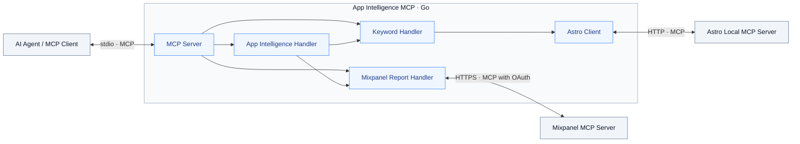

# App Intelligence MCP

A local Go MCP server that brings Astro App Store rankings and Mixpanel product analytics together in one tool call.

> **Early development:** Astro and Mixpanel work together over stdio. Tool contracts may change.

## Current capabilities

- MCP server built with the official Go SDK, exposing a local stdio interface
- Astro integration through its local Streamable HTTP MCP server
- Keyword rankings filtered by keyword, store, platform, and optional App Store ID
- Structured output distinguishing ranked, missing, and outside-chart values
- Provider update timestamps preserved in results
- Dated historical comparisons in tool output with explicit availability statuses
- Saved Mixpanel reports through Mixpanel MCP with browser-based OAuth
- One combined response containing Astro rankings and a saved Mixpanel report
- Unit tests, offline MCP integration tests, and opt-in live Astro and subprocess stdio tests

## Requirements

- macOS on Apple Silicon for the prebuilt package
- Go 1.26.3 or later when building from source
- For live use: Astro running on the same machine with its MCP server enabled
- An Astro version exposing `get_keyword_performance`
- For Mixpanel tools: a Mixpanel project with MCP access enabled and a saved report you can read

The application connects to the endpoint configured by `ASTRO_MCP_ENDPOINT`, defaulting to `http://127.0.0.1:8089/mcp`, during startup. If the connection fails, the application exits. Normal tests use a fake provider and require neither Astro nor a Claude subscription.

## Getting started

Download `app-intelligence-mcp-v0.1.0-darwin-arm64.dmg` and its
`.dmg.sha256` file from
[GitHub Releases](https://github.com/nodemt/app-intelligence-mcp/releases).
From the download directory, verify the disk image:

```sh
shasum -a 256 -c app-intelligence-mcp-v0.1.0-darwin-arm64.dmg.sha256
```

Open the disk image and copy its contents into a folder on your Mac, for
example `~/Applications/app-intelligence-mcp`. Eject the disk image and open
a terminal in the copied folder for the login step below. Use the copied
binary's absolute path in your MCP client configuration. The binary runs
without Go.

### Build from source

If you prefer to build it yourself, run these commands from the repository directory:

```sh
go mod download
go test ./...
go build -o app-intelligence-mcp .
```

### Sign in to Mixpanel

Enable Astro's MCP server for normal server startup. For Mixpanel, use the
MCP endpoint for your project's region. This example uses the EU endpoint.

```sh
MIXPANEL_MCP_ENDPOINT=https://mcp-eu.mixpanel.com/mcp \
  ./app-intelligence-mcp mixpanel-login
```

Open the URL printed in the terminal, grant access in your browser, and
wait for `Mixpanel login saved`. Run this command under the same OS user
that launches the MCP client. It stores the access token in the user's
configuration directory under `app-intelligence-mcp/mixpanel-login.json`.
Run the login command again when the token expires or you switch endpoints.

### Connect Codex CLI

Add the following to `~/.codex/config.toml`. Replace the binary path and
`MIXPANEL_PROJECT_ID` with your own values. Use the same Mixpanel endpoint
as in the login command.

```toml
[mcp_servers.app_intelligence]
command = "/absolute/path/to/app-intelligence-mcp"
startup_timeout_sec = 30

[mcp_servers.app_intelligence.env]
ASTRO_MCP_ENDPOINT = "http://127.0.0.1:8089/mcp"
MIXPANEL_MCP_ENDPOINT = "https://mcp-eu.mixpanel.com/mcp"
MIXPANEL_PROJECT_ID = "123456"
```

Start Codex and run `/mcp` to check that `app_intelligence` is connected.
The combined tool was verified from Codex CLI, including a restart that
reused the saved Mixpanel login.

### Connect another stdio client

For clients that accept an `mcpServers` configuration, the same setup
looks like this:

```json
{
	"mcpServers": {
		"app-intelligence": {
			"command": "/absolute/path/to/app-intelligence-mcp",
			"env": {
				"ASTRO_MCP_ENDPOINT": "http://127.0.0.1:8089/mcp",
				"MIXPANEL_MCP_ENDPOINT": "https://mcp-eu.mixpanel.com/mcp",
				"MIXPANEL_PROJECT_ID": "123456"
			}
		}
	}
}
```

Replace `command` with the absolute path to your compiled binary.
Configuration locations and supported fields depend on the client.
Leave the Mixpanel variables unset to run with Astro alone.

The binary waits for MCP messages; it does not provide an interactive
prompt or expose its own HTTP endpoint. Protocol messages use stdout;
application logs use stderr.

Subprocess startup, tool discovery, and live Astro tool invocation over
stdio have also been verified using the official Go SDK client.

## Tool `get_app_intelligence`

Pass an Astro keyword query and the bookmark ID of a saved Mixpanel
report for the same app. You can also pass `app_id` to restrict the
Astro results to one App Store ID.

```json
{
  "keyword": "dibujo digital",
  "store": "es",
  "platform": "iphone",
  "bookmark_id": 12345678
}
```

The response contains rankings in `astro.rankings` and the saved report
in `mixpanel`. With OAuth, metric data appears under `mixpanel.results`.
This excerpt uses a demo event:

```json
{
  "astro": {
    "rankings": [
      {
        "app": "Example App",
        "keyword": "dibujo digital",
        "current_rank": null,
        "current_rank_status": "outside_charts"
      }
    ]
  },
  "mixpanel": {
    "results": {
      "Total Events of MCP Demo App Opened": {
        "headers": ["date", "value"],
        "rows": [["2026-11-08T07:00", 1]]
      }
    }
  }
}
```

The two sources retain their own dates. Choose the matching report and
check its date range against the Astro comparison before interpreting
the metrics together. An empty report is a valid result. A provider
failure returns a tool error identifying the source.

## Tool `get_saved_product_report`

Reads the Mixpanel report on its own. Pass the positive `bookmark_id`
from the saved report URL, using a report in the configured project.
The OAuth path returns report data in `results`. The direct Query API
path uses `series` and requires a Mixpanel plan that permits API queries.
See `.env.example` for the configuration variables.

## Tool: `get_keyword_rankings`

Queries Astro's `get_keyword_performance` tool and returns normalized records.

### Input

```json
{
	"keyword": "dibujo digital",
	"store": "es",
	"platform": "iphone"
}
```

| Field      | Meaning                                                                             |
| ---------- | ----------------------------------------------------------------------------------- |
| `keyword`  | Search text; Astro uses case-insensitive partial matching                           |
| `store`    | App Store country code, such as `es` or `us`                                        |
| `platform` | Astro platform: `iphone`, `ipad`, `mac`, `appletv`, or `realityDevice`              |
| `app_id`   | Optional numeric App Store ID. When omitted, results are not restricted to one app. |

`keyword`, `store`, and `platform` are required; `app_id` is optional. The handler rejects blank keywords and stores, and unsupported platforms before calling the provider. Store codes are not yet checked against an authoritative list. App IDs are passed to Astro as strings; numeric-format validation is not currently enforced.

### Structured output

Illustrative response; values depend on the user's tracked data:

```json
{
	"rankings": [
		{
			"app": "Example App",
			"keyword": "dibujo digital",
			"store": "es",
			"platform": "iphone",
			"current_rank": null,
			"current_rank_status": "outside_charts",
			"previous_rank": null,
			"previous_rank_status": "outside_charts",
			"last_update": "2026-11-01T12:44:24Z",
			"comparison": {
				"status": "outside_charts",
				"from": "2026-04-01T22:08:57Z",
				"to": "2026-11-01T12:44:24Z",
				"rank_change": null
			}
		}
	]
}
```

| Provider value             | Output rank | Status           |
| -------------------------- | ----------- | ---------------- |
| Normal rank, such as `131` | `131`       | `ranked`         |
| Missing or null            | `null`      | `missing`        |
| Astro sentinel `1000`      | `null`      | `outside_charts` |

No matching records produce a successful `{"rankings": []}` response. Provider failures produce tool execution errors.

### Historical comparison

Each record includes a `comparison` object. `from` and `to` identify the first and last returned historical observations; they do not imply a fixed seven-day or thirty-day period. When available, `rank_change` is calculated as first rank minus last rank: positive means improvement and negative means decline.

| Comparison status   | Meaning                                                                    | Rank change                        |
| ------------------- | -------------------------------------------------------------------------- | ---------------------------------- |
| `available`         | At least two observations and both endpoint ranks are present and in-chart | Calculated integer, including zero |
| `insufficient_data` | Fewer than two observations                                                | `null`                             |
| `missing_rank`      | An endpoint rank is missing                                                | `null`                             |
| `outside_charts`    | An endpoint uses Astro's `1000` sentinel                                   | `null`                             |

With fewer than two observations, both comparison dates are `null`. Otherwise the endpoint dates are preserved even when the rank difference is unavailable. Intermediate out-of-chart observations are not summarized by this endpoint comparison. History is expected in Astro's documented oldest-first order.

### Interpretation limits

- Partial keyword matching can return multiple records, even with an app filter. Supply `app_id` to restrict results to one tracked app.
- `last_update` is the provider's data timestamp, not the tool invocation time. Data may be stale; no freshness threshold is enforced.
- `previous_rank` has no separate timestamp. Do not interpret it as a seven-day comparison.
- The provider client requests all available history. The main tool exposes a comparison of its first and last observations, but does not expose the full history array or a selectable date range.
- Out-of-chart values must not be treated as numeric positions in rank-difference calculations.

## Architecture

The application serves callers over MCP and connects upstream to Astro and Mixpanel.



`KeywordHandler` depends on the `RankingProvider` interface. The application supplies an `astro.Client`; offline tests supply a fake provider. The client handles MCP calls and decoding. The handler maps provider records into the public tool output, normalizes ranks, and builds dated comparison results. Provider requests have a bounded context deadline and retain earlier caller deadlines.

| Location             | Responsibility                                                      |
| -------------------- | ------------------------------------------------------------------- |
| Root application     | Server setup, tool contracts, handler, and provider interface       |
| `internal/astro`     | Connection, provider types, normalization, and history calculations |
| `internal/mixpanel`  | Report clients, OAuth login, and local access-token storage         |
| `cmd/astro-probe`    | Separate discovery and live-data inspection program                 |
| `cmd/mixpanel-probe` | Separate OAuth and report inspection program                        |
| Root tests           | Offline MCP tests and opt-in live Astro / subprocess stdio tests    |
| `internal/constants` | Shared application, MCP, and Astro constants                        |

The probe is a separate developer tool and is not invoked by the main server. Both the probe and the main tool use the history comparison logic from `internal/astro`.

The MCP server exposes tools; it is not an LLM or an agent runtime.

## Development and testing

Format and run offline tests:

```sh
go fmt ./...
go test ./... -v
```

Run the offline MCP test alone:

```sh
go test -run '^TestKeywordRankingsTool$' -v .
```

Run the opt-in in-memory MCP test backed by live Astro data, with Astro open and its MCP server enabled:

```sh
go test -tags=integration -run '^TestAstroConnectionLive$' -v .
```

Verify the compiled application's stdio startup, discovery, and tool invocation:

```sh
go build -o app-intelligence-mcp .
go test -tags=integration -run '^TestStdioConnectionLive$' -v .
```

Rebuild the binary after application changes: the stdio test runs the existing binary and does not build it automatically.

The live tests currently query `dibujo digital` in `es` on `iphone`. Adjust these values for your own tracked data. They check calls for errors and log responses; complete automated assertions on the live result structure are still pending. Live tests are excluded from normal runs by an `integration` build tag.

Inspect Astro tools and history:

```sh
go run ./cmd/astro-probe
```

The probe also contains example query values that should be adjusted for your data.

## Data and security

Tool results can leave the local machine through the connected AI client. Review the data you expose and your client's data-handling policies.

The exposed tools read data. SIGINT and SIGTERM cancel the application context so it can close its provider connections. Treat provider text as data. Keep the local Mixpanel login file, credentials, and private analytics fixtures out of source control and published logs.

Remote hosting, multi-user authorization, and production security hardening are outside the current implementation.

## License

Licensed under the [MIT License](LICENSE).
